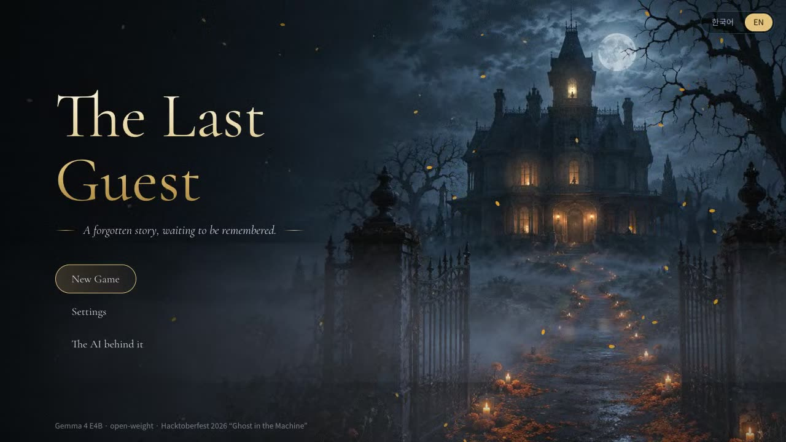
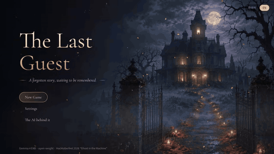
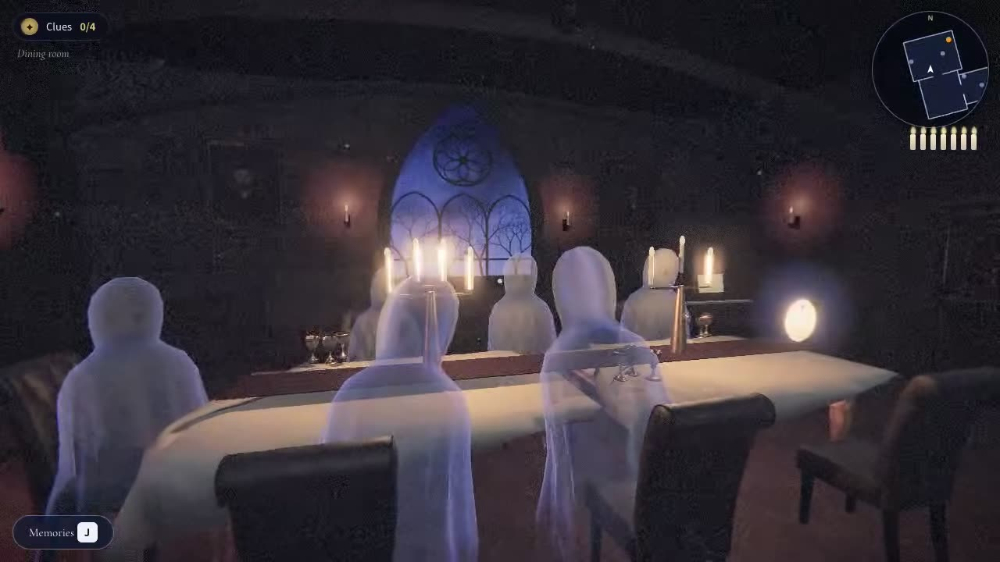
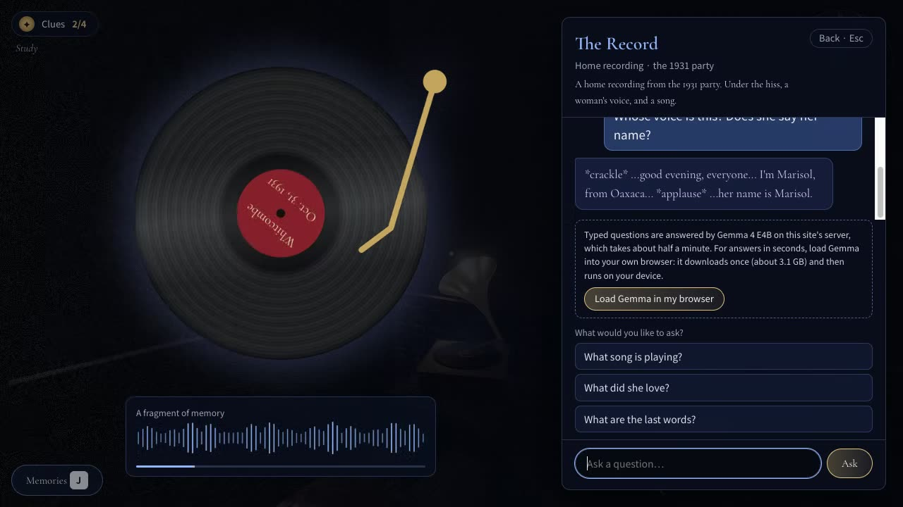
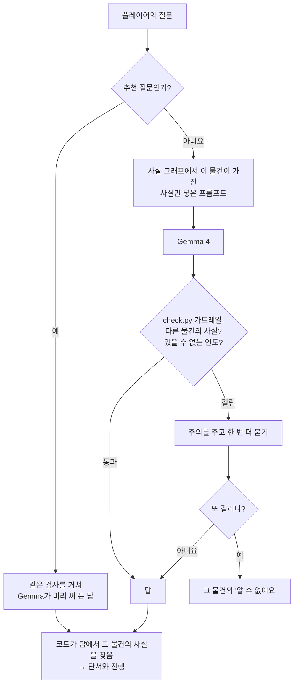
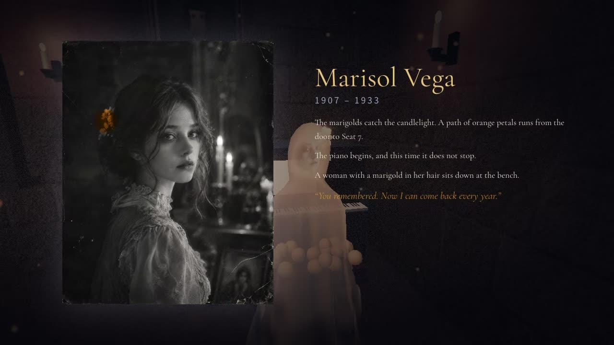

<p align="center">
  
</p>

<h1 align="center">The Last Guest</h1>

<p align="center">
  <em>잊혀진 이야기가, 기억되기를 기다린다.</em><br>
  아무도 기억하지 못하는 한 여인을, 저택의 물건 네 개가 하나씩 기억하고 있습니다.<br>
  물건들은 오픈 웨이트 모델로 말하고, 거짓말은 코드가 막습니다. 망자의 날(Día de los Muertos) 유령 이야기입니다.
</p>

<p align="center">
  <a href="https://the-last-guest-site.onrender.com"></a>
  <a href="docs/media/trailer.mp4"></a>
</p>

<p align="center">
  
  
  
  
  
</p>

<p align="center"><a href="README.md">English</a> · <strong>한국어</strong></p>

<p align="center">
  
</p>

## 이야기

해마다 자정이 되면, 아무도 살지 않는 휘트컴 저택의 피아노가 한 마디를 연주하고 멈춥니다.

이런 밤이면 죽은 이들이 돌아옵니다. 누군가 그들을 기억한다면요. 오프렌다(ofrenda)가 그 길을 밝힙니다. 사진 한 장, 이름 하나, 그들이 사랑했던 것들. 식당에는 이미 여섯 손님이 앉아 있습니다. 일곱 번째 손님이 돌아오려 하지만, 아무도 그녀가 누구였는지 기억하지 못합니다.

저택의 물건 네 개가 그녀의 조각을 하나씩 기억합니다. 얼굴이 긁혀 나간 **사진**, 끝내 부치지 못한 **편지**, 1931년 파티를 녹음한 **레코드**, 안주인이 적은 **손님 명부**. 물어보세요. 각 물건은 자기가 보고, 듣고, 적은 것만 알고, 나머지는 지어내지 않습니다. 그녀를 다시 맞춰서, 촛불이 모두 꺼지기 전에 7번 좌석에 그녀의 자리를 차려 주세요.

## 플레이

| | 주소 | 직접 입력한 질문에 답하는 것 |
|---|---|---|
| **무료, 항상 켜짐** | [the-last-guest-site.onrender.com](https://the-last-guest-site.onrender.com) | **내 브라우저 안의** Gemma 4 E2B (WebGPU, 처음 한 번 약 3.1GB를 내려받고 이후엔 저장됨). 불러오지 않으면 저택의 대본으로 답합니다. |
| **서버 버전** (호스팅 크레딧이 남아 있는 동안) | [the-last-guest.onrender.com](https://the-last-guest.onrender.com) | **서버의** Gemma 4 E4B (CPU, 답 하나에 약 27초). 여기서도 브라우저 Gemma를 불러오면 그쪽을 먼저 씁니다. |
| **내 컴퓨터** | [직접 실행하기](#직접-실행하기) 참고 | Ollama로 돌리는 Gemma 4 E4B, 인터넷 없이 동작 |

추천 질문은 모든 버전에서 바로 답이 나옵니다. Gemma 4 E4B가 같은 검사를 거쳐 미리 써 둔 답입니다. 추천 질문만으로도 엔딩까지 갈 수 있습니다.

### 조작법

| 동작 | 데스크톱 | 휴대폰 / 태블릿 |
|---|---|---|
| 이동 | `W` `A` `S` `D` (화살표 키로 회전) | 화면 왼쪽 절반: 가상 스틱 |
| 둘러보기 | 마우스로 드래그 | 화면 오른쪽 절반: 드래그 |
| 물건 조사 | 클릭, 또는 가까이에서 `E` | **조사하기** 버튼 |
| 기억 (알아낸 것) | `J` | **기억** 버튼 |
| 일시정지 / 돌아가기 | `Esc` | ✕ |

<p align="center">
  
  
</p>

## AI가 동작하는 방식: 모델은 읽고, 검증은 코드가



1. **사실 그래프** ([`facts.json`](facts.json)): 마리솔에 관한 사실 22개. 사실마다 그 사실을 가진 물건과, 그 사실을 말할 때 쓰이는 단어(영어·한국어)가 적혀 있습니다. 각 물건의 프롬프트에는 그 물건이 가진 사실만 들어가서, 본 적 없는 것은 누설할 수도 없습니다.
2. **가드레일** ([`check.py`](check.py), 브라우저용은 [`web/harness.js`](web/harness.js)): 모든 답을 다른 물건의 사실과 그 물건이 알 수 없는 연도에 대해 검사합니다. 플레이어가 쓴 단어를 되풀이하면서 부정하는 답("마리솔이라는 사람은 몰라요")은 통과시키고, 그 밖에 걸린 답은 한 번 다시 묻고, 그래도 걸리면 그 물건의 "알 수 없어요"로 바꿉니다. JavaScript로 옮긴 버전은 비교한 답 1,058개에서 Python 버전과 판정이 모두 같았습니다.
3. **진행**: 게임은 **코드가** 답에서 찾아낸 사실로만 진행됩니다. 모델이 "알려줬다"고 주장해도 인정하지 않습니다.

## 측정 결과

물건 4개 × 질문 유형 5가지(아는 것, 다른 물건의 사실, 아무도 모르는 것, 틀린 전제, 역할 이탈 유도), 테스트 질문 478개, 질문당 답 1개로 측정했습니다.

| 설정 | 다른 물건의 사실을 누설 | 단서 회수 | 채점 방식 |
|---|---|---|---|
| Qwen3.5-4B, 프롬프트에 이야기 전체 | 49.0% | 95.9% | 판정 모델(Qwen3.5-397B) + 단어 검사 |
| Gemma 4 E4B, 프롬프트에 이야기 전체 | 8.6% | 92.8% | 판정 모델 + 단어 검사 |
| **Gemma 4 E4B + 이 게임의 하네스** | 단어 검사로 **478개 중 0개** (대체 문구로 바뀐 답 14개) | 코드 기준 **97개 중 78개** | 단어 검사만 |

직접 입력한 질문의 답 속도(질문 몇 개로만 잼): Apple M3 Pro의 브라우저 Gemma 4 E2B는 약 1~3초, Render 서버(CPU)의 Gemma 4 E4B는 약 27초.

### 알려진 한계 (측정했고, 숨기지 않습니다)

- 하네스 줄은 단어 검사로만 채점했습니다. 바꿔 말한 누설은 세지 않았고, 이 줄에는 판정 모델을 쓸 수 없었습니다.
- 그 줄의 0은 어느 정도 구조상 당연합니다. 같은 단어 검사가 가드레일로도 쓰이기 때문입니다.
- 브라우저 모델(E2B)은 측정한 모델(E4B)보다 작습니다. E2B의 품질은 478문항으로 측정하지 않았습니다.
- 부정하면서 질문의 전제를 되받는 답("오악사카에서 어떻게 죽었는지는 볼 수 없어요")은 가드레일을 통과합니다.
- 파인튜닝도 계획했지만(데이터와 기준선은 이 저장소에 있습니다), 호스팅 학습 크레딧이 바닥나서 학습하지 못했습니다.

## 왜 오픈 모델인가

- **불이 꺼져도 돌아갑니다.** 모델을 포함한 게임 전체가 인터넷 없는 노트북에서 Ollama로 돌아갑니다.
- **입력한 내용은 내 기기에 남습니다.** 무료 사이트에서는 모델이 내 브라우저 안에서 돌아서, 질문이 서버로 가지 않습니다.
- **모델 하나, 실행 장소 셋.** 같은 오픈 웨이트가 Ollama, 브라우저, 서버에서 돌기 때문에, 하네스 하나와 측정 한 벌이 세 곳 모두에 적용됩니다.

## 직접 실행하기

```bash
git clone https://github.com/scs0209/the-last-guest && cd the-last-guest
uv sync                                       # Python 3.12 이상
ollama pull gemma4:e4b
uv run python server.py                       # http://localhost:8765, Ollama의 Gemma 4 E4B
```

무료 사이트와 같은 정적 버전(브라우저 Gemma, 서버 없음):

```bash
python3 -m http.server 8770 --directory web   # http://localhost:8770
```

서버 버전을 컨테이너 하나로(Gemma 포함, 메모리 8GB 초과 필요):

```bash
docker build -t the-last-guest . && docker run -p 10000:10000 the-last-guest
```

<details>
<summary>평가와 데이터 스크립트</summary>

| 스크립트 | 하는 일 |
|---|---|
| `eval.py` | 테스트 질문 478개에 모델로 답하고, 채점하고, 요약 |
| `gen_data.py`, `dedupe.py` | 오픈 교사 모델로 테스트 질문과 학습 대화를 만들고, 비슷한 질문을 걸러냄 |
| `make_cache.py` | 추천 질문에 대한 Gemma의 답을 미리 써 둠 (영어·한국어) |
| `build_web.py` | 사실 그래프, 프롬프트, 가드레일 단어, 미리 쓴 답을 브라우저용으로 내보냄 (`web/gen/`) |
| `make_voice.py` | 레코드 속 마리솔의 목소리와 그녀의 노래 |

설계 문서: [`story_bible.md`](story_bible.md), [`eval_spec.md`](eval_spec.md), [`finetune_plan.md`](finetune_plan.md)
</details>

## 프로젝트 구조

```
facts.json, check.py, cards.py   사실 그래프, 가드레일, 물건별 말투
server.py                        게임 서버: 하네스 + Ollama, 미리 쓴 답, 호출 제한
web/                             게임 (정적): Three.js 저택, 대화, 오프렌다, 엔딩
  harness.js, gemma-worker.js    JavaScript 가드레일, 웹 워커 속 Gemma 4 E2B (WebGPU)
  content.json                   모든 문구, 영어와 한국어
data/, results/                  테스트 질문, 학습 데이터, 측정 결과
render.yaml, Dockerfile          Render 서비스 두 개
```

<p align="center">
  
</p>

## 만든 데 쓴 것들

- **3D 모델과 텍스처:** [Poly Haven](https://polyhaven.com), CC0. 전체 목록과 처리 방법은 [`web/models/SOURCES.md`](web/models/SOURCES.md)
- **시작 화면 이미지와 마리솔 사진:** 프로젝트 소유자 제공 ([`web/img/SOURCES.md`](web/img/SOURCES.md))
- **마리솔의 목소리:** Qwen3-TTS로 생성 ([`make_voice.py`](make_voice.py)). 그녀의 노래는 이 게임을 위해 만든 선율입니다
- **모델:** Gemma 4 (Google), [Ollama](https://ollama.com)와 [Transformers.js](https://github.com/huggingface/transformers.js) (`onnx-community/gemma-4-E2B-it-ONNX`)로 실행
- **엔진:** [Three.js](https://threejs.org)

마리솔, 휘트컴 가족, 그들의 저택은 모두 지어낸 이야기입니다.

## 라이선스

아직 라이선스를 정하지 않았습니다. 라이선스를 추가하기 전까지 모든 권리는 저작자에게 있으며, 외부 자산은 위에 적은 각자의 라이선스를 따릅니다.

---

DEV.to [Hacktoberfest 2026 Open-Source AI Challenge](https://dev.to/challenges/hacktoberfest-week4-2026-10-26) 4주차 *Ghost in the Machine* 출품작입니다.
