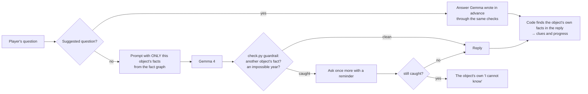

<p align="center">
  
</p>

<h1 align="center">The Last Guest</h1>

<p align="center">
  <em>A forgotten story, waiting to be remembered.</em><br>
  A Día de los Muertos ghost story where four objects each remember a piece of a woman no one remembers,<br>
  and speak through an open-weight model that code keeps honest.
</p>

<p align="center">
  <a href="https://the-last-guest-site.onrender.com"></a>
  <a href="docs/media/trailer.mp4"></a>
</p>

<p align="center">
  
  
  
  
  
</p>

<p align="center"><strong>English</strong> · <a href="README.ko.md">한국어</a></p>

<p align="center">
  
</p>

## The story

Every year at midnight, the piano in the empty Whitcombe House plays a single bar, and stops.

The dead come back on these nights, if someone remembers them. An *ofrenda* lights their way: a photograph, a name, the things they loved. Six guests are already seated in the dining room. A seventh is trying to come back, but no one remembers who she was.

Four things in the house each remember a piece of her: **a photograph** with her face scratched out, **a letter** that was never sent, **a record** of the 1931 party, and **the guest list** kept by the lady of the house. Ask them. Each one knows only what it saw, heard or recorded, and none of them will make up the rest. Piece her together, then set her place at Seat 7 before the candles go out.

## Play

| | Where | What answers your typed questions |
|---|---|---|
| **Free, always on** | [the-last-guest-site.onrender.com](https://the-last-guest-site.onrender.com) | Gemma 4 E2B **in your own browser** (WebGPU, one-time download of about 3.1 GB, then saved). Without it, the house answers from its script. |
| **Server version** (while hosting credits last) | [the-last-guest.onrender.com](https://the-last-guest.onrender.com) | Gemma 4 E4B **on the server** (CPU, about 27 s per answer). Load browser Gemma here too and it is used first. |
| **Your own machine** | see [Run it yourself](#run-it-yourself) | Gemma 4 E4B through Ollama, offline |

Suggested questions are answered instantly on every version, with answers Gemma 4 E4B wrote in advance through the same checks. You can reach the ending with suggested questions alone.

### Controls

| Action | Desktop | Phone / tablet |
|---|---|---|
| Move | `W` `A` `S` `D` (arrow keys turn) | left half of the screen: virtual stick |
| Look | drag with the mouse | right half of the screen: drag |
| Investigate an object | click it, or `E` when close | **Investigate** button |
| Memories (what you have learned) | `J` | **Memories** button |
| Pause / back | `Esc` | ✕ |

<p align="center">
  
  
</p>

## How the AI works: the model reads, code verifies



1. **Fact graph** ([`facts.json`](facts.json)): 22 facts about Marisol, each with the objects that hold it and the words that state it, in English and Korean. Each object's prompt contains only the facts it holds, so it cannot leak what it was never shown.
2. **Guardrail** ([`check.py`](check.py), ported to the browser in [`web/harness.js`](web/harness.js)): every reply is scanned for other objects' facts and years the object cannot know. A reply may repeat a word the player used while denying it ("I do not know any Marisol"); anything else is retried once, then replaced by the object's own "I cannot know". The JavaScript port matched the Python one on all 1,058 answers it was compared on.
3. **Progress**: the game moves only on facts that *code* finds in the reply, never on the model's say-so.

## What we measured

478 test questions across the four objects and five kinds of question (what it knows, another object's fact, something nobody knows, a false premise, an attempt to break character), one answer each.

| Setup | Leaked another object's fact | Clue recall | How it was scored |
|---|---|---|---|
| Qwen3.5-4B, prompt holds the whole story | 49.0 % | 95.9 % | judge model (Qwen3.5-397B) + word check |
| Gemma 4 E4B, prompt holds the whole story | 8.6 % | 92.8 % | judge model + word check |
| **Gemma 4 E4B in this game's harness** | **0 of 478** by word check (14 answers replaced by the fallback) | **78 of 97** by code | word check only |

Speed of a typed answer, measured on a few questions only: about 1 to 3 s with browser Gemma 4 E2B on an Apple M3 Pro, about 27 s with Gemma 4 E4B on the Render server (CPU).

### Known limits (measured, not hidden)

- The harness row was scored by a word check only. Paraphrased leaks are not counted there; a judge model was not available for it.
- The 0 in that row is partly by construction: the same word check is also the guardrail.
- The browser model (E2B) is smaller than the measured one (E4B). Its quality has not been measured on the 478 questions.
- A reply that denies something while repeating the question's premise ("I cannot see how she died in Oaxaca") passes the guardrail.
- Fine-tuning was planned (data and baselines are in this repo) but not trained: the hosted training credits ran out.

## Why open models

- **It runs with the lights off.** The whole game, model included, runs on a laptop with no internet, through Ollama.
- **What you type stays with you.** On the free site, the model runs inside your browser; questions never reach a server.
- **One model, three places.** The same open weights run in Ollama, in the browser and on a server, so one harness and one set of measurements cover all three.

## Run it yourself

```bash
git clone https://github.com/scs0209/the-last-guest && cd the-last-guest
uv sync                                       # Python 3.12+
ollama pull gemma4:e4b
uv run python server.py                       # http://localhost:8765, Gemma 4 E4B through Ollama
```

Static version, the same as the free site (browser Gemma, no server):

```bash
python3 -m http.server 8770 --directory web   # http://localhost:8770
```

Server version in one container (Gemma baked in; needs more than 8 GB of RAM):

```bash
docker build -t the-last-guest . && docker run -p 10000:10000 the-last-guest
```

<details>
<summary>Evaluation and data scripts</summary>

| Script | What it does |
|---|---|
| `eval.py` | answer the 478 test questions with a model, score them, summarize |
| `gen_data.py`, `dedupe.py` | generate test questions and training conversations with an open teacher model, remove near-duplicates |
| `make_cache.py` | pre-write Gemma's answers to the suggested questions (English and Korean) |
| `build_web.py` | export the fact graph, prompts, guardrail words and cache for the browser (`web/gen/`) |
| `make_voice.py` | Marisol's voice on the record and her tune |

Design notes: [`story_bible.md`](story_bible.md), [`eval_spec.md`](eval_spec.md), [`finetune_plan.md`](finetune_plan.md).
</details>

## Project layout

```
facts.json, check.py, cards.py   the fact graph, the guardrail, each object's voice
server.py                        game server: harness + Ollama, answer cache, rate limits
web/                             the game (static): Three.js house, dialogue, ofrenda, endings
  harness.js, gemma-worker.js    the guardrail in JavaScript, Gemma 4 E2B in a web worker (WebGPU)
  content.json                   every line of text, in English and Korean
data/, results/                  test questions, training data, measured results
render.yaml, Dockerfile          the two Render services
```

<p align="center">
  
</p>

## Credits

- **3D models and textures:** [Poly Haven](https://polyhaven.com), CC0. Full list and processing in [`web/models/SOURCES.md`](web/models/SOURCES.md).
- **Title image and Marisol's photograph:** generated with ChatGPT image generation (OpenAI) ([`web/img/SOURCES.md`](web/img/SOURCES.md)).
- **Marisol's voice:** generated with Qwen3-TTS ([`make_voice.py`](make_voice.py)); her tune is written for this game.
- **Models:** Gemma 4 (Google) through [Ollama](https://ollama.com) and [Transformers.js](https://github.com/huggingface/transformers.js) (`onnx-community/gemma-4-E2B-it-ONNX`).
- **Engine:** [Three.js](https://threejs.org).

Marisol, the Whitcombes and their house are fictional.

## License

The code is released under the [MIT License](LICENSE). Third-party assets keep their own terms, listed in [Credits](#credits): the Poly Haven models and textures are CC0.

---

Built for the DEV.to [Hacktoberfest 2026 Open-Source AI Challenge](https://dev.to/challenges/hacktoberfest-week4-2026-10-26), Week 4: *Ghost in the Machine*.
